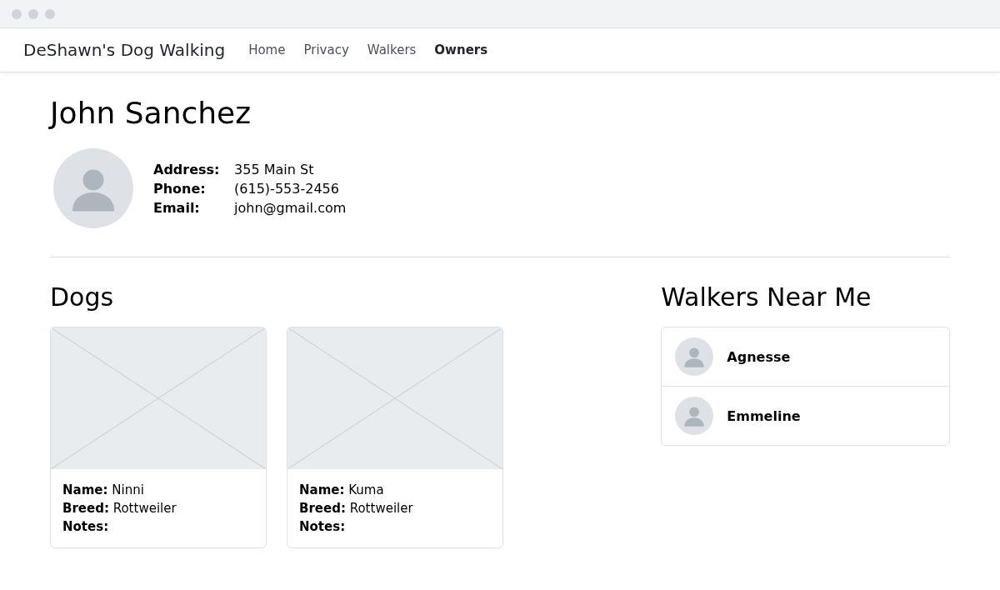
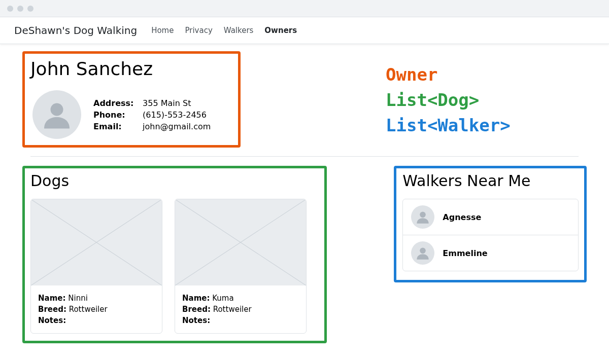

# View Models
We've seen how controllers are able to pass objects into our views, and how views expect a certain type of object. For example, your `Details` action for owners passes a single owner to its view:

> OwnersController.cs
```csharp
public IActionResult Details(int id)
{
    ...

    return View(owner);
}
```

and the view expects an `Owner`:

> Views/Owners/Details.cshtml
```html+razor
@model Owner
```

The view then builds its HTML from the properties of that owner. This works out fine if the page you're creating only needs owner information on it. Let's consider a more realistic scenario, though. Say DeShawn asks for a more complex owner details page. Here is the mockup you're given:



This view seems to need more data than just an `Owner` object. There's now information about the owner's dogs, and the walkers in their city, as well.

The problem is that in ASP.NET, we can only pass a view **one** thing. So how do we pass it multiple things?

The answer is to wrap all of the things up in a single class called a _view model_. The difference between regular models and view models is that regular models are meant to mimic the shape of our database tables. View models are meant to mimic the shape of our HTML pages. It may be helpful to think of view models as similar to React state. Looking at the mockup again, what are the things on the page that would belong in state?



- An `Owner` object
- A list of `Dog`s
- A list of `Walker`s

Let's create a view model that contains all of these things. Create a folder inside of your `Models` folder and name it `ViewModels`. Within that folder, create a file called `ProfileViewModel.cs` and add the following code:
> ProfileViewModel.cs
```csharp
namespace DeShawnsRazor.Models.ViewModels;

public class ProfileViewModel
{
    public Owner Owner { get; set; }
    public List<Dog> Dogs { get; set; }
    public List<Walker> Walkers { get; set; }
}
```

Now update the `Details` action in the `OwnersController`, so that it gets all of the data the page needs and passes it to the view in a `ProfileViewModel`:
> OwnersController.cs
```csharp
// GET: Owners/Details/5
public IActionResult Details(int id)
{
    Owner? owner = _dbContext.Owners.SingleOrDefault(o => o.Id == id);

    if (owner == null)
    {
        return NotFound();
    }

    List<Dog> dogs = //Get all of the dogs that belong to this owner
    List<Walker> walkers = //Get all of the walkers in this owner's city

    ProfileViewModel vm = new ProfileViewModel()
    {
        Owner = owner,
        Dogs = dogs,
        Walkers = walkers
    };

    return View(vm);
}
```
Fill in the two queries, and add `using DeShawnsRazor.Models.ViewModels;` to the top of the `OwnersController` so that it can use `ProfileViewModel`. (If you did the challenge in the Owners exercise and included the owner's `Dogs` in your query, you can remove that now, since the dogs have their own place in the view model.)

Try running the application now and going to `/Owners/Details/1`. You should see this error message:
```sh
InvalidOperationException: The model item passed into the ViewDataDictionary is of type 'DeShawnsRazor.Models.ViewModels.ProfileViewModel', but this ViewDataDictionary instance requires a model item of type 'DeShawnsRazor.Models.Owner'.
```
This is because the controller is now passing the view an instance of `ProfileViewModel`, but the view is still expecting an `Owner`. You'll see this error any time a controller passes a view a different type of object than its `@model` says it expects. Fix this by changing the first line of `Details.cshtml` to this:
```html+razor
@model DeShawnsRazor.Models.ViewModels.ProfileViewModel
```

Now replace the rest of the view with the following code:
> Views/Owners/Details.cshtml
```html+razor
@model DeShawnsRazor.Models.ViewModels.ProfileViewModel

@{
    ViewData["Title"] = "Profile";
}

<div>
    <h1 class="mb-4">@Model.Owner.Name</h1>

    <section class="container">
        
        <div>
            <label class="fw-bold">Address:</label>
            <span>@Model.Owner.Address</span>
        </div>
        <div>
            <label class="fw-bold">Phone:</label>
            <span>@Model.Owner.Phone</span>
        </div>
        <div>
            <label class="fw-bold">Email:</label>
            <span>@Model.Owner.Email</span>
        </div>
    </section>

    <hr class="mt-5" />
    <div class="clearfix"></div>

    <div class="row">
        <section class="col-8 container mt-5">
            <h1 class="text-start">Dogs</h1>

            <div class="row">
                @foreach (Dog dog in Model.Dogs)
                {
                    <div class="card m-4" style="width: 18rem;">
                        @if (String.IsNullOrEmpty(dog.ImageUrl))
                        {
                            
                        }
                        else
                        {
                            
                        }
                        <div class="card-body">
                            <div>
                                <label class="fw-bold">Name:</label>
                                <span>@dog.Name</span>
                            </div>
                            <div>
                                <label class="fw-bold">Breed:</label>
                                <span>@dog.Breed</span>
                            </div>
                            <div>
                                <label class="fw-bold">Notes:</label>
                                <p>@dog.Notes</p>
                            </div>
                        </div>
                    </div>
                }
            </div>
        </section>

        <section class="col-lg-4 col-md-8 container mt-5">
            <h1>Walkers Near Me</h1>

            <ul class="list-group mt-4">
                @foreach (Walker walker in Model.Walkers)
                {
                    <li class="list-group-item">
                        
                        <span class="fw-bold ms-4">@walker.Name</span>
                    </li>
                }
            </ul>
        </section>
    </div>
</div>
```
Notice that the `@if` statement inside the `@foreach` loop checks whether a dog has an image, and shows a placeholder picture if it doesn't. None of the dogs in the seed data have one, so you'll see the placeholder on every card. Run the application and go to `/Owners/Details/1` to see the new profile page.

## Using view models with forms
Currently the Create and Edit forms for owners have a text input field to collect an owner's `CityId`. It was mentioned earlier that we'd ideally like to have that be a dropdown list instead. We can make this happen with view models. Once again, let's think about what we'd need to have in _state_ if this were a React application:

- Properties for all the owner form fields
- A list of available options for the dropdown

Create a new class inside the `ViewModels` folder and name it `OwnerFormViewModel`. Add the following code:
> OwnerFormViewModel.cs
```csharp
namespace DeShawnsRazor.Models.ViewModels;

public class OwnerFormViewModel
{
    public Owner Owner { get; set; }
    public List<City> Cities { get; set; }
}
```

Update the `GET` `Create` action to create a view model and pass it to the view:
> OwnersController.cs
```csharp
// GET: Owners/Create
public IActionResult Create()
{
    OwnerFormViewModel vm = new OwnerFormViewModel()
    {
        Owner = new Owner(),
        Cities = _dbContext.Cities.ToList()
    };

    return View(vm);
}
```

Now update the view to accept an instance of an `OwnerFormViewModel`, and change the `CityId` field from an `<input>` to a `<select>`:
> Views/Owners/Create.cshtml
```html+razor
@model DeShawnsRazor.Models.ViewModels.OwnerFormViewModel

@{
    ViewData["Title"] = "New Owner";
}

<h1>New Owner</h1>

<div class="row">
    <div class="col-md-4">
        <form asp-action="Create">
            <div class="mb-3">
                <label asp-for="Owner.Name" class="form-label"></label>
                <input asp-for="Owner.Name" class="form-control" />
            </div>
            <div class="mb-3">
                <label asp-for="Owner.Email" class="form-label"></label>
                <input asp-for="Owner.Email" class="form-control" />
            </div>
            <div class="mb-3">
                <label asp-for="Owner.Phone" class="form-label"></label>
                <input asp-for="Owner.Phone" class="form-control" />
            </div>
            <div class="mb-3">
                <label asp-for="Owner.Address" class="form-label"></label>
                <input asp-for="Owner.Address" class="form-control" />
            </div>
            <div class="mb-3">
                <label asp-for="Owner.CityId" class="form-label"></label>
                <select asp-for="Owner.CityId" class="form-select">
                    <option value="0">Select City</option>
                    @foreach (City city in Model.Cities)
                    {
                        <option value="@city.Id">@city.Name</option>
                    }
                </select>
            </div>
            <input type="submit" value="Create" class="btn btn-primary" />
        </form>
    </div>
</div>

<div class="mt-3">
    <a asp-action="Index">Back to List</a>
</div>
```
Since the model is now an `OwnerFormViewModel` instead of an `Owner`, every `asp-for` now starts with `Owner.`. View the page source of the form, and you'll see that the inputs' `name` attributes changed to match, like `name="Owner.Name"`.

### Submitting the form
You don't need to change the parameter of the `POST` `Create` action. It can still accept an `Owner`, because model binding is smart about those new names: the action's parameter is named `owner`, so the framework fills it in with all of the form values whose names start with `Owner.`.

There is one thing you do need to change, though. If saving the owner fails, the action returns `View(owner)`. But the view now expects an `OwnerFormViewModel`, so that line would cause the same `InvalidOperationException` you saw earlier. Update the `catch` block to build a view model, including the cities for the dropdown, and pass that to the view instead:
> OwnersController.cs
```csharp
catch (DbUpdateException)
{
    OwnerFormViewModel vm = new OwnerFormViewModel()
    {
        Owner = owner,
        Cities = _dbContext.Cities.ToList()
    };

    return View(vm);
}
```
Run the application and create a new owner, choosing a city from the dropdown.

## Practice: Editing with a view model
Update the `/Owners/Edit/{id}` page to use the `OwnerFormViewModel`, so that the city uses a dropdown instead of an input field.
1. Update the `GET` `Edit` action to pass an `OwnerFormViewModel` to the view, with the owner being edited and the list of cities.
1. Update `Edit.cshtml` to use the view model, the same way you updated `Create.cshtml`.
1. The hidden `Id` input in `Edit.cshtml` now needs to be `<input asp-for="Owner.Id" type="hidden" />`. This is the situation the hidden input was for: the route's `id` can't fill in `Owner.Id`, so without this input, the owner that gets bound has an `Id` of `0`, and `Update` will _add_ a new owner instead of updating the existing one.
1. Update the `catch` block in the `POST` `Edit` action, the same way you did for `Create`.

Up Next: [Validation](./deshawns-08-validation.md)

## 🔍 Additional Materials
1. [Views in ASP.NET Core MVC: passing data to views](https://learn.microsoft.com/en-us/aspnet/core/mvc/views/overview#pass-data-to-views)
