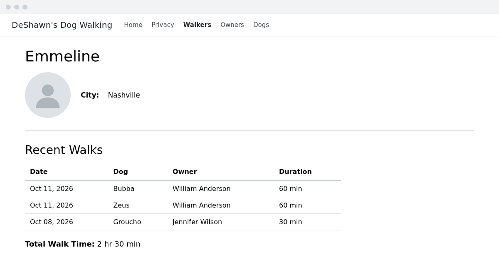

# Dogs
In this exercise you'll put everything from this book together on your own. Use the earlier exercises as a reference for the patterns, not a script to copy.

## Dog CRUD
Create a `DogsController` that gives users the following functionality:
1. View a list of all dogs, with each dog's name, breed, and owner's name. (See [Getting all walkers](./deshawns-04-walkers.md#getting-all-walkers).)
1. View the details of a single dog. (See [Getting a single walker](./deshawns-04-walkers.md#getting-a-single-walker).)
1. Create a new dog, choosing the dog's owner from a dropdown. You'll need a `DogFormViewModel` with the dog and a list of owners. (See [Creating an owner](./deshawns-06-forms.md#creating-an-owner) and [Using view models with forms](./deshawns-07-view-models.md#using-view-models-with-forms).)
1. Edit a dog. Don't forget the hidden `Id`. (See [Editing an owner](./deshawns-06-forms.md#editing-an-owner) and [Practice: Editing with a view model](./deshawns-07-view-models.md#practice-editing-with-a-view-model).)
1. Delete a dog. (See [Deleting an owner](./deshawns-06-forms.md#deleting-an-owner).)
1. Add a "Dogs" link to the navigation bar.

Then add validation to the dog forms (see [Validation](./deshawns-08-validation.md#adding-validation-rules-to-owner)):
1. Add attributes to the `Dog` model so that a dog's name and breed have a reasonable maximum length, a user has to choose an owner, and the label for the owner dropdown says "Owner" instead of "OwnerId". If any of your attributes change the database schema, remember to add a migration.
1. Check `ModelState.IsValid` in the `POST` actions, and display the errors in the forms.

## Walker details
Update the walker details page at `/Walkers/Details/{id}` to match this design:

1. The page needs more than just a `Walker` now, so it needs a view model.
1. Show the most recent walks first.
1. Use the `DateTime` class to help format the date strings. Its `ToString` method can take a format, like `walk.Date.ToString("MMM dd, yyyy")`.
1. The total walk time is the sum of the durations of all of the walker's walks, which are in minutes. Display it in hours and minutes.

## Challenges
**Challenge:** Create a form that allows the user to create several new `Walk` records at once. It should allow the user to select a single walker and _multiple_ dogs, as well as enter a date and a duration for the walk. Each dog gets its own `Walk` record.

> **NOTE:** You should use a "multi-select" to select more than one dog. If your view model has a `List<int>` property for the chosen dogs' `Id`s, a `<select>` with `asp-for` on that property will let the user choose more than one, and model binding will fill the list in.

**Advanced Challenge:** Create a page that allows a user to select multiple walks and delete them all.

> **NOTE:** You could use a "multi-select" to select more than one walk ...OR you _could_ use checkboxes.

This is the end of DeShawn's Dog Walking III. Head back to the [book 5 table of contents](../README.md) to see what's next.
