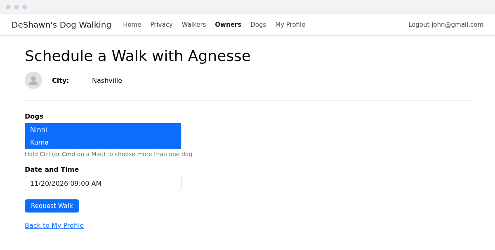
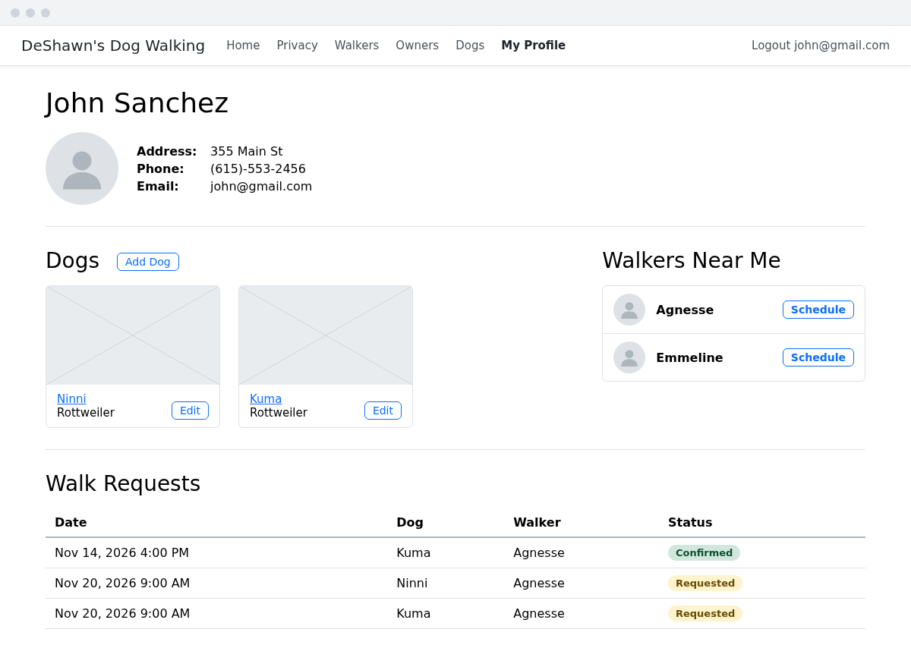
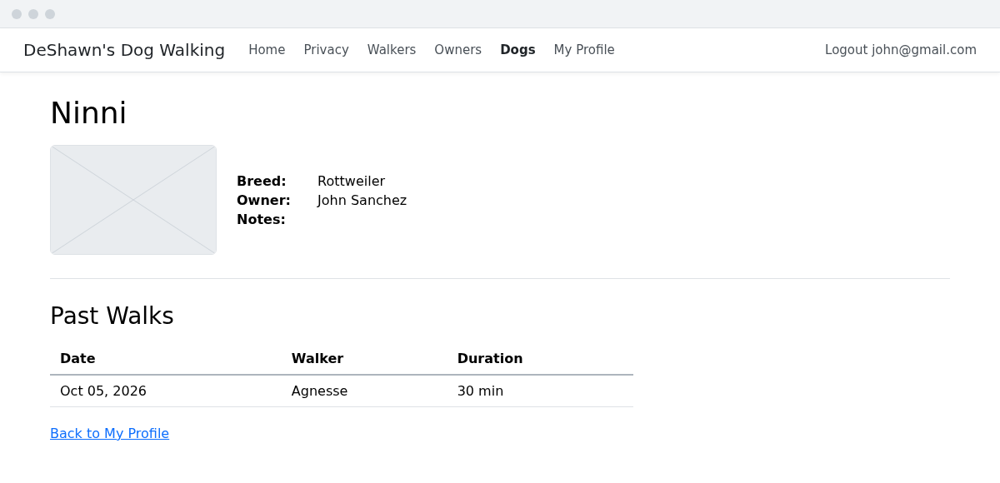
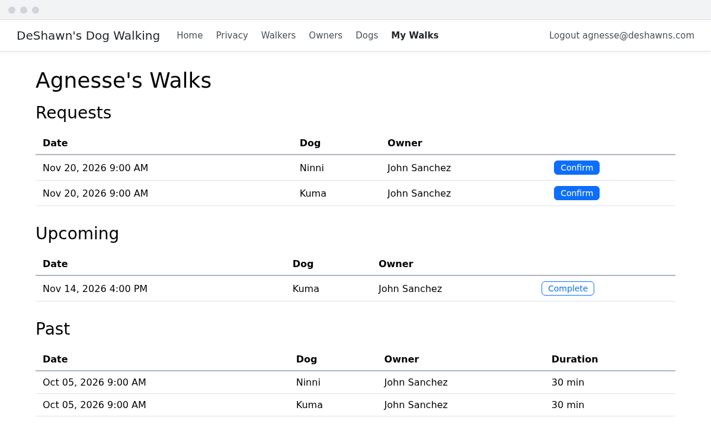
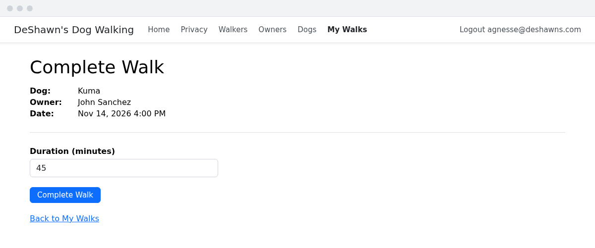

# 🐕‍🦺 🐩 Refining DeShawn's

## This is an _Optional_ Project
DeShawn's site is working, but right now it's really only useful to DeShawn. In this project, you'll turn it into something owners and walkers can use themselves: owners will log in and request walks for their dogs, and walkers will log in to confirm and complete them. There are three parts. The first two walk you through two new concepts, enums and logging in, and the third is a set of requirements for you to build on your own.

Make sure you've finished all of DeShawn's Dog Walking III before starting, since this project builds on every exercise.

## Part 1: Walk statuses
A walk is going to go through three stages: an owner _requests_ it, the walker _confirms_ it, and once the walk is over, the walker marks it _completed_. So every walk needs a status, and there are exactly three statuses it can have.

You could store the status in a lookup table, the way you stored cities. But there's an important difference between cities and statuses. Cities are data: DeShawn could expand to a new city tomorrow, and nothing in your code would need to change. Statuses aren't like that. Your code is going to make decisions based on them, like only showing a "Confirm" button for a walk that has been requested. With a lookup table, that code would have to look something like `walk.WalkStatusId == 1`, and anyone reading it would have to go look up what `1` means.

### Enums
C# has a better tool for a value that can only be one of a small, fixed set of options: an _enum_ (short for _enumeration_). Add a `WalkStatus.cs` file to the `Models` folder:
> WalkStatus.cs
```csharp
namespace DeShawnsRazor.Models;

public enum WalkStatus
{
    Requested,
    Confirmed,
    Completed
}
```
`WalkStatus` is a new type, just like a class is. But instead of properties, it lists the only values that a `WalkStatus` can ever be. You use them like this:
```csharp
WalkStatus status = WalkStatus.Requested;

if (status == WalkStatus.Requested)
{
    Console.WriteLine("This walk needs to be confirmed");
}
```
Now the code says exactly what it means, and if you misspell a status, the compiler will catch it. Enums are everywhere in C#. You've probably used one already without noticing: `DateTime`'s `DayOfWeek` property is a `DayOfWeek` enum, with values like `DayOfWeek.Monday`.

Behind the scenes, each value of an enum is a number, starting at `0`. That means `Requested` is `0`, and since `0` is the default value for a number in C#, a `WalkStatus` that hasn't been given a value will be `Requested`. That's why `Requested` is listed first: every new walk will start out as requested.

### Updating the models
Add a `Status` property to the `Walk` model, and make `Duration` nullable, since a walk that has only been requested hasn't happened yet:
> Walk.cs
```csharp
public class Walk
{
    public int Id { get; set; }
    public DateTime Date { get; set; }
    public int? Duration { get; set; }
    public WalkStatus Status { get; set; }
    public int DogId { get; set; }
    public Dog? Dog { get; set; }
    public int WalkerId { get; set; }
    public Walker? Walker { get; set; }
}
```
Walkers are going to log in too, using their email address, so add an `Email` property to the `Walker` model:
> Walker.cs
```csharp
public string Email { get; set; }
```

### Storing the status as text
Because enum values are numbers, EF Core will store `Status` in the database as a number by default. That works, but when you look at the `Walks` table in pgAdmin, you'll see `0`, `1`, and `2`, and have to remember which is which. You can tell EF Core to store the name of the value instead. Add this to the bottom of the `OnModelCreating` method in `DeShawnsRazorDbContext`:
```csharp
modelBuilder.Entity<Walk>()
    .Property(w => w.Status)
    .HasConversion<string>();
```

### Updating the seed data
1. All of the walks in the seed data are in the past, so add `Status = WalkStatus.Completed` to each of them.
1. `Email` is required, so every walker in the seed data needs one, like `Email = "claudelle@deshawns.com"`. Since walkers will log in with their email address, make sure each one is unique. (There are two walkers named Cully!)

### The migration
Stop the app, then run:
```
dotnet ef migrations add WalkStatusAndWalkerEmail
dotnet ef database update
```
Open the `Walks` table in pgAdmin, and you should see `Completed` in the new `Status` column.

> :bulb: Making `Duration` nullable affects the total walk time on the walker details page, because summing a list of `int?`s gives you an `int?`. Only completed walks have a duration anyway, so update that calculation to only include completed walks.

## Part 2: Logging in
Right now, anyone can do anything in the app. Owners should only be able to request walks for their own dogs, and walkers should only be able to confirm their own walks. To make that possible, the app needs to know _who_ is using it (authentication) and _what_ they're allowed to do (authorization). You learned what those two words mean, and how cookies make them work, in [Bianca's Bike Shop](../../book-4-controllers/chapters/biancas-03-auth.md#definitions). In Bianca's, all of the code that logged users in was already written for you. This time, you'll write a simple version of it yourself.

> **IMPORTANT NOTE:** Creating a secure system for authentication and authorization is both incredibly important and very complex. Bianca's Bike Shop used ASP.NET's Identity framework to safely store and check passwords. In this project, we're going to skip the password step and implement a lite version of auth, where users only enter their email address to log in. Never do this in a real application!

### The login view model
The login form only needs to capture an email address. Add a `LoginViewModel.cs` file to the `ViewModels` folder:
> LoginViewModel.cs
```csharp
using System.ComponentModel.DataAnnotations;

namespace DeShawnsRazor.Models.ViewModels;

public class LoginViewModel
{
    [EmailAddress]
    public string Email { get; set; }
}
```

### The login actions
We'd like the URL for the login form to be `/Owners/Login`, so add these two actions to the `OwnersController` (once again, we need two: the first to `GET` the form, and the second to handle the `POST` when the form is submitted):
> OwnersController.cs
```csharp
// GET: Owners/Login
public IActionResult Login()
{
    return View();
}

// POST: Owners/Login
[HttpPost]
[ValidateAntiForgeryToken]
public async Task<IActionResult> Login(LoginViewModel viewModel)
{
    Owner? owner = _dbContext.Owners.SingleOrDefault(o => o.Email == viewModel.Email);

    if (owner == null)
    {
        ModelState.AddModelError("", "There is no owner with that email address.");
        return View(viewModel);
    }

    List<Claim> claims = new List<Claim>
    {
        new Claim(ClaimTypes.NameIdentifier, owner.Id.ToString()),
        new Claim(ClaimTypes.Email, owner.Email),
        new Claim(ClaimTypes.Role, "Owner"),
    };

    ClaimsIdentity claimsIdentity = new ClaimsIdentity(
        claims, CookieAuthenticationDefaults.AuthenticationScheme);

    await HttpContext.SignInAsync(
        CookieAuthenticationDefaults.AuthenticationScheme,
        new ClaimsPrincipal(claimsIdentity));

    return RedirectToAction("Details", new { id = owner.Id });
}

// GET: Owners/Logout
public async Task<IActionResult> Logout()
{
    await HttpContext.SignOutAsync();
    return RedirectToAction("Index", "Home");
}
```
Add these using directives to the top of the `OwnersController`:
```csharp
using System.Security.Claims;
using Microsoft.AspNetCore.Authentication;
using Microsoft.AspNetCore.Authentication.Cookies;
```

The `GET` action for `Login` should feel pretty familiar, but the `POST` action has some new code in it. It looks up an owner by their email address, and if it finds one, it saves some of the owner's data into a cookie. The way this works is that when a user successfully logs in, the server creates something that's almost like a driver's license. The server fills in that license with whatever information it chooses. Each piece of information is a _claim_, and in this case our code is choosing to add the owner's `Id`, email address, and role. `SignInAsync` then puts the license in a cookie, and sends it back to the browser. After logging in, every time the owner makes a request to the server, the browser will automatically send that cookie along with it, and ASP.NET will read it to know who is making the request.

Two other small things are new here:
1. `RedirectToAction("Details", new { id = owner.Id })` redirects to the owner's details page. The second argument fills in the route's `id`, the same job `asp-route-id` does in a view.
1. `RedirectToAction("Index", "Home")` in `Logout` redirects to an action in a _different_ controller, so it names the controller as well.

### Telling ASP.NET to use cookies
We have to let ASP.NET know that we plan on using cookies for authentication. Add this using directive to the top of `Program.cs`:
```csharp
using Microsoft.AspNetCore.Authentication.Cookies;
```
Then add this right above `var app = builder.Build();`:
```csharp
builder.Services.AddAuthentication(CookieAuthenticationDefaults.AuthenticationScheme)
    .AddCookie(options => options.LoginPath = "/Owners/Login");
```
Finally, find the `app.UseAuthorization();` line that's already there, and add `app.UseAuthentication();` right above it:
```csharp
app.UseAuthentication();
app.UseAuthorization();
```
The order matters: ASP.NET has to figure out _who_ is making a request (authentication) before it can decide _what_ they're allowed to do (authorization).

### The login form
Add a `Login.cshtml` file to the `Views/Owners` folder:
> Views/Owners/Login.cshtml
```html+razor
@model DeShawnsRazor.Models.ViewModels.LoginViewModel

@{
    ViewData["Title"] = "Log In";
}

<h1>Log In</h1>

<div class="row">
    <div class="col-md-4">
        <form asp-action="Login">
            <div asp-validation-summary="ModelOnly" class="text-danger"></div>
            <div class="mb-3">
                <label asp-for="Email" class="form-label"></label>
                <input asp-for="Email" class="form-control" />
                <span asp-validation-for="Email" class="text-danger"></span>
            </div>
            <input type="submit" value="Log In" class="btn btn-primary" />
        </form>
    </div>
</div>
```
Run the app, go to `/Owners/Login`, and log in with an owner's email address from the seed data, like `john@gmail.com`. You should land on John's profile page. You can confirm it worked by finding the cookie in your browser's dev tools (in Chrome, it's under **Application**, then **Cookies**).

### Getting the current user
After a user logs in, every controller can see the claims from their cookie in its `User` property, just like the controllers in Bianca's. Getting the `Id` of the current user is something you'll need to do many times, so add this private helper method to the bottom of the `OwnersController`:
> OwnersController.cs
```csharp
private int GetCurrentUserId()
{
    string? id = User.FindFirstValue(ClaimTypes.NameIdentifier);
    return int.Parse(id!);
}
```
`id` is nullable because there won't be a claim if no one is logged in. The `!` after `id` tells the compiler that we know it won't be `null` here. That's only true because of the next step.

Now use it to give a logged-in owner a quick way to get to their own profile. Add this action to the `OwnersController`:
> OwnersController.cs
```csharp
// GET: Owners/Profile
[Authorize]
public IActionResult Profile()
{
    return RedirectToAction("Details", new { id = GetCurrentUserId() });
}
```
`[Authorize]` works just like it did in Bianca's, with one difference. In a web API, a request without a cookie gets a `401` response. In an MVC app, it gets _redirected_ to the `LoginPath` you set in `Program.cs`, which is much friendlier for someone using a browser. (`Authorize` needs `using Microsoft.AspNetCore.Authorization;` at the top of the controller.)

Log out by going to `/Owners/Logout`, then go to `/Owners/Profile`. You should be redirected to the login page. Log in, and go to `/Owners/Profile` again to land on your profile.

### Customizing the navbar
The navbar should change depending on whether someone is logged in:
- If someone comes to the app and they are not logged in, they should see a link to log in.
- If an owner is logged in, they should see a link to their profile, and a link to log out that shows their email address.

Add this right after the `<li>` for the Dogs link in `_Layout.cshtml`:
> Views/Shared/_Layout.cshtml
```html+razor
@if (User.Identity?.IsAuthenticated == true)
{
    @if (User.IsInRole("Owner"))
    {
        <li class="nav-item">
            <a class="nav-link text-dark" asp-area="" asp-controller="Owners" asp-action="Profile">My Profile</a>
        </li>
    }
    <li class="nav-item">
        <a class="nav-link text-dark" asp-area="" asp-controller="Owners" asp-action="Logout">
            Logout @User.FindFirstValue(ClaimTypes.Email)
        </a>
    </li>
}
else
{
    <li class="nav-item">
        <a class="nav-link text-dark" asp-area="" asp-controller="Owners" asp-action="Login">Login</a>
    </li>
}
```
Views can see the current user's claims through `User` too. `User.IsInRole("Owner")` checks the role claim you added when the owner logged in, so walkers won't see the "My Profile" link once they can log in. You'll need to add a `using` directive at the top of `_Layout.cshtml` for it to know about the `ClaimTypes` class:
```html+razor
@using System.Security.Claims
```

## Part 3: Requirements
Now it's your turn. Use everything from DeShawn's Dog Walking III, and the first two parts of this project, to build the following features. The wireframes below each requirement show one way to lay out the pages, but feel free to make them your own.

1. On the login page, users should be able to choose between logging in as an owner or as a walker. A walker logs in with their email address, and their cookie should have a role of `Walker`.
1. The Owners Create page should be turned into the registration page for owners. (The page doesn't need to change, other than maybe a new heading.) Add a link to it from the login page.
1. Owners should only be able to edit or delete their own dogs. If an owner goes to `/Dogs/Edit/5` or `/Dogs/Delete/5` and they don't own that dog, they should get a 404 Not Found response.
1. An owner looking at their own details page should have buttons to add a dog and to edit the dogs they've already added. When a logged-in owner adds a dog, the new dog's owner should be the logged-in owner, instead of being chosen from a dropdown.
1. An owner should be able to pick a walker from the Walkers Near Me list on their details page, then pick which of their dogs to be walked and a date and time. This creates a walk for each dog chosen, with a `Requested` status.

    

1. An owner looking at their own details page should be able to see a list of their walk requests, including whether each one is requested or confirmed.

    

1. An owner should be able to go from their own details page to the details page of any of their dogs, where they can see a list of that dog's past walks.

    

1. A logged-in walker should be able to see a list of all of their walks: requests waiting to be confirmed, upcoming walks they've confirmed, and past walks they've completed.

    

1. A walker should be able to confirm a walk request, which updates its status to `Confirmed`, so that it shows up in their upcoming walks. Walkers should only be able to confirm their own walks.
1. A walker should be able to complete an upcoming walk, by entering how long the walk was. This sets the walk's `Duration`, and updates its status to `Completed`.

    

### Tips
1. There's no need for a create page for walkers.
1. For requirement 4, your dog form's validation requires an owner to be chosen. Once the owner comes from the cookie instead of the form, that rule will fail every time, because the form no longer sends an `OwnerId`. Look up `ModelState.Remove` to get around this.
1. For requirement 5, the multi-select challenge from the Dogs exercise is a good place to start.

## 🔍 Additional Materials
1. [Enumeration types](https://learn.microsoft.com/en-us/dotnet/csharp/language-reference/builtin-types/enum)
1. [EF Core value conversions](https://learn.microsoft.com/en-us/ef/core/modeling/value-conversions)
1. [Use cookie authentication without ASP.NET Core Identity](https://learn.microsoft.com/en-us/aspnet/core/security/authentication/cookie)
