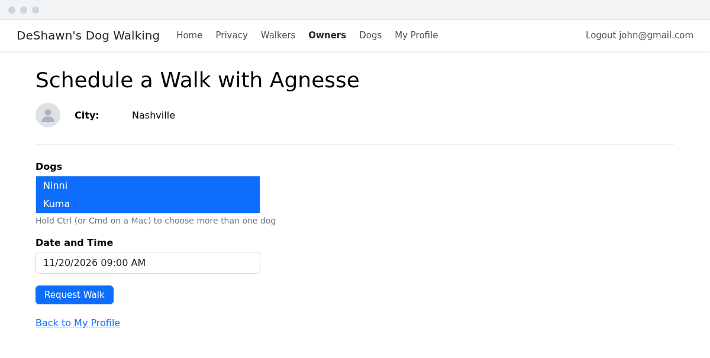
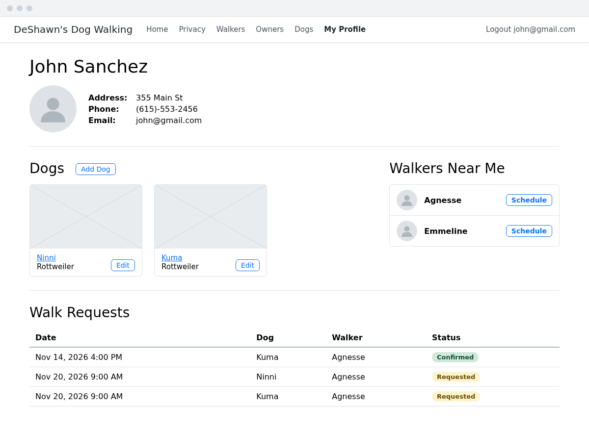
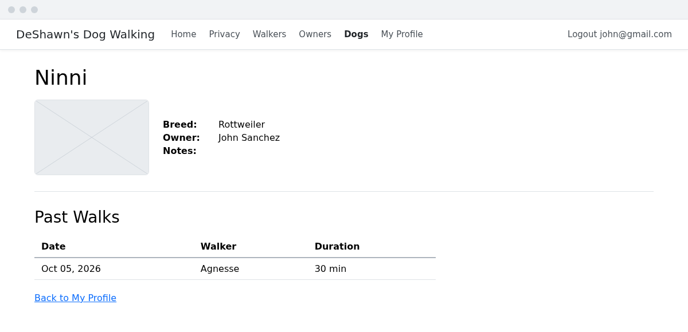
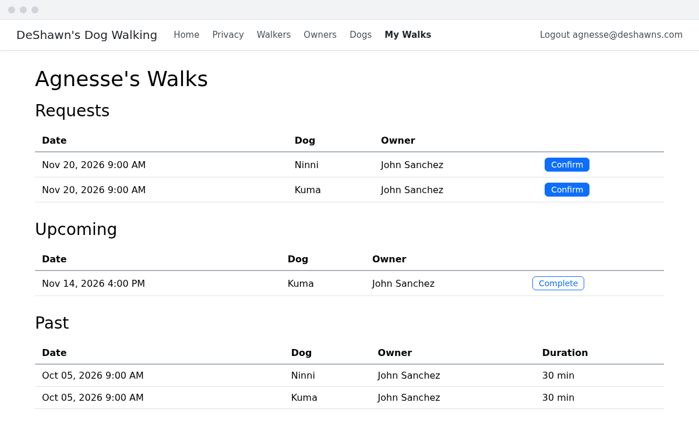
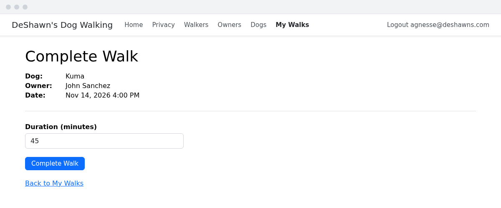

# Requirements
Now it's your turn. Use everything from DeShawn's Dog Walking III, and the first two exercises of Refining DeShawn's, to build the following features. The wireframes below each requirement show one way to lay out the pages, but feel free to make them your own.

1. On the login page, users should be able to choose between logging in as an owner or as a walker. A walker logs in with their email address, and their cookie should have a role of `Walker`.
1. The Owners Create page should be turned into the registration page for owners. (The page doesn't need to change, other than maybe a new heading.) Add a link to it from the login page.
1. Owners should only be able to edit or delete their own dogs. If an owner goes to `/Dogs/Edit/5` or `/Dogs/Delete/5` and they don't own that dog, they should get a 404 Not Found response.
1. An owner looking at their own details page should have buttons to add a dog and to edit the dogs they've already added. When a logged-in owner adds a dog, the new dog's owner should be the logged-in owner, instead of being chosen from a dropdown.
1. An owner should be able to pick a walker from the Walkers Near Me list on their details page, then pick which of their dogs to be walked and a date and time. This creates a walk for each dog chosen, with a `Requested` status.

    

1. An owner looking at their own details page should be able to see a list of their walk requests, including whether each one is requested or confirmed.

    

1. An owner should be able to go from their own details page to the details page of any of their dogs, where they can see a list of that dog's past walks.

    

1. A logged-in walker should be able to see a list of all of their walks: requests waiting to be confirmed, upcoming walks they've confirmed, and past walks they've completed.

    

1. A walker should be able to confirm a walk request, which updates its status to `Confirmed`, so that it shows up in their upcoming walks. Walkers should only be able to confirm their own walks.
1. A walker should be able to complete an upcoming walk, by entering how long the walk was. This sets the walk's `Duration`, and updates its status to `Completed`.

    

## Tips
1. There's no need for a create page for walkers.
1. For requirement 4, your dog form's validation requires an owner to be chosen. Once the owner comes from the cookie instead of the form, that rule will fail every time, because the form no longer sends an `OwnerId`. Look up `ModelState.Remove` to get around this.
1. For requirement 5, the multi-select challenge from the Dogs exercise is a good place to start.

This is the end of Refining DeShawn's. Head back to the [book 5 table of contents](../README.md) to see what's next.
